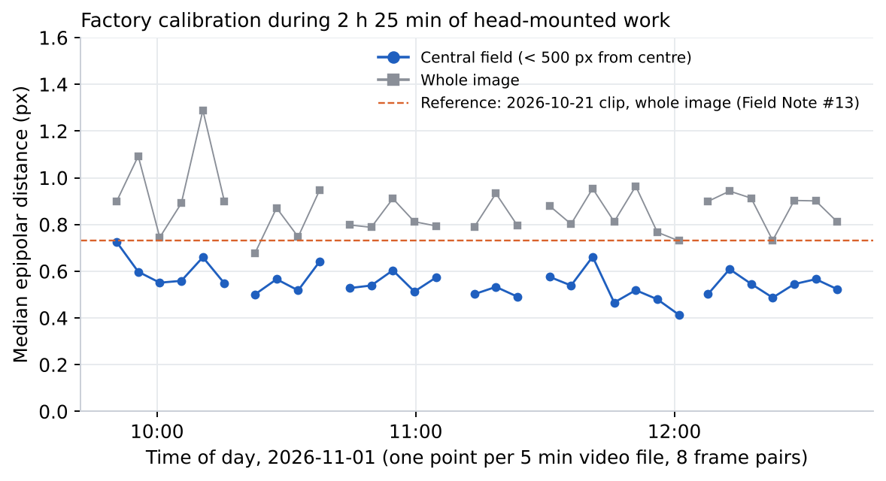
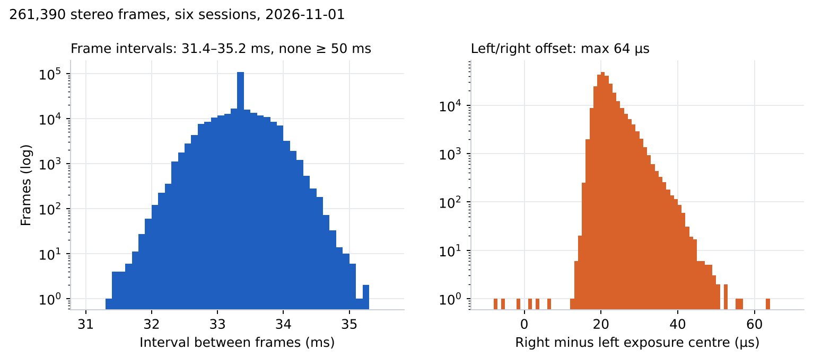

<!-- ODL_QUALITY_V2 -->

# Origin Data Lab · Technical Field Note #16

**ODL Long-Session Stereo IMU Integrity**

[](https://github.com/origin-data-lab/real-work-session-recording-integrity-calibration-holdup) [](https://huggingface.co/datasets/origin-data-lab/real-work-session-recording-integrity-calibration-holdup) [](https://www.kaggle.com/datasets/origindatalab/odl-long-session-stereo-integrity) [](https://origindatalab.io/technical-field-notes/real-work-session-recording-integrity-calibration-holdup.html)

[English technical note](https://origindatalab.io/technical-field-notes/real-work-session-recording-integrity-calibration-holdup.html) | [Korean technical note](https://origindatalab.io/ko/technical-field-notes/real-work-session-recording-integrity-calibration-holdup.html)

---

# ODL Field Note #16 — Long-session integrity and calibration hold-up
```bash
pip install numpy pandas opencv-contrib-python-headless pyyaml matplotlib
python3 analysis/b1_integrity.py <packs_dir> out      # frames, sync, boundaries, IMU, device log
python3 analysis/b3_calib_holdup.py <packs_dir> out   # per-file target-free epipolar check
```
Input packs are produced on the capture PC by `odl_pack_for_analysis.py` (SEI CSVs, .imu, .log, 8 frame pairs per file). Not distributed.
Licence: Creative Commons Attribution 4.0 International (CC BY 4.0) for derived data and figures; MIT for code.

## Visual evidence

Figures are taken from the released technical-note package. Interpret with the original methods and limitations.

### Figure 1



*Median epipolar distance per 5-minute file, central field and whole image, with the earlier reference.*

### Figure 2



*Frame interval and left/right exposure offset for every frame of the six sessions.*


<!-- ODL_ENTITY_V1 -->
## About Origin Data Lab

**Origin Data Lab** (origindatalab.io, OriginDataLab Co., Ltd.) is a real-world data collection company based in **Yangyang, Gangwon State, South Korea**.
We plan and run egocentric, stereo+IMU and field video capture for physical AI and robotics teams, with documented QA such as the measurements in this dataset.
Not affiliated with "Origin Lab" (game data) or "OriginLab" (Origin/OriginPro software).

- **[Request sample data](https://origindatalab.io/contact.html?topic=sample&note=fn16&utm_source=github&utm_medium=referral&utm_campaign=field-notes)**: stereo+IMU or phone+IMU egocentric capture
- **[Custom data collection](https://origindatalab.io/data-services.html?utm_source=github&utm_medium=referral)**: field capture in South Korea and Bangladesh
- **[All technical field notes](https://origindatalab.io/technical-field-notes/?utm_source=github&utm_medium=referral)**

---

## Explore Origin Data Lab

[](https://github.com/origin-data-lab/real-work-session-recording-integrity-calibration-holdup) [](https://huggingface.co/datasets/origin-data-lab/real-work-session-recording-integrity-calibration-holdup) [](https://www.kaggle.com/datasets/origindatalab/odl-long-session-stereo-integrity) [](https://origindatalab.io/technical-field-notes/real-work-session-recording-integrity-calibration-holdup.html)

[Official Website](https://origindatalab.io/) | [Technical Field Notes](https://origindatalab.io/technical-field-notes/) | [English Note](https://origindatalab.io/technical-field-notes/real-work-session-recording-integrity-calibration-holdup.html) | [Korean Note](https://origindatalab.io/ko/technical-field-notes/real-work-session-recording-integrity-calibration-holdup.html)

[GitHub](https://github.com/origin-data-lab/real-work-session-recording-integrity-calibration-holdup) | [Hugging Face](https://huggingface.co/datasets/origin-data-lab/real-work-session-recording-integrity-calibration-holdup) | [Kaggle Dataset](https://www.kaggle.com/datasets/origindatalab/odl-long-session-stereo-integrity) | [Kaggle Notebook](https://www.kaggle.com/code/origindatalab/odl-long-session-stereo-integrity-notebook)
